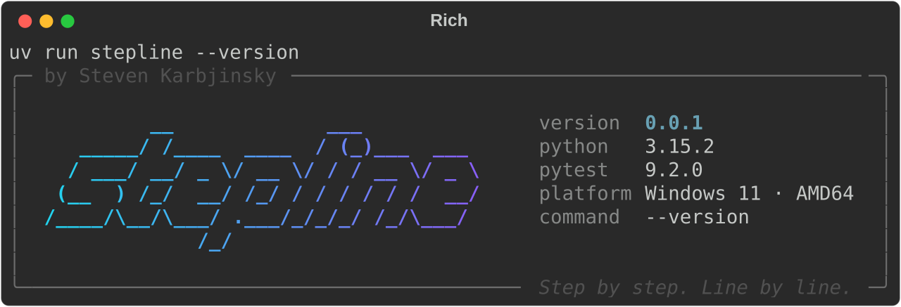

<p align="center">
    <picture>
        <source media="(prefers-color-scheme: dark)" srcset="https://raw.githubusercontent.com/xKabbe/stepline/main/docs/assets/brand/stepline-logo-tagline-800.png">
        
    </picture>
</p>

<p align="center">
    <a href="https://pypi.org/project/pytest-stepline/"></a>
    <a href="https://pypi.org/project/pytest-stepline/"></a>
    <a href="https://docs.pytest.org/en/stable/"></a>
    <a href="https://github.com/xKabbe/stepline/blob/main/LICENSE"></a>
</p>

<p align="center">
    <a href="https://github.com/xKabbe/stepline/actions/workflows/ci.yml"></a>
    <a href="https://github.com/xKabbe/stepline/actions/workflows/ci.yml"></a>
    <a href="https://xkabbe.github.io/stepline/"></a>
    <a href="https://github.com/microsoft/pyright"></a>
    <a href="https://github.com/astral-sh/ruff"></a>
    <a href="https://github.com/astral-sh/uv"></a>
    <a href="https://zensical.org/"></a>
    <a href="https://www.conventionalcommits.org"></a>
</p>

<p align="center">
    <a href="https://xkabbe.github.io/stepline/">Documentation</a> ·
    <a href="https://pypi.org/project/pytest-stepline/">PyPI</a> ·
    <a href="https://github.com/xKabbe/stepline/blob/main/CHANGELOG.md">Changelog</a> ·
    <a href="https://github.com/xKabbe/stepline/milestones">Roadmap</a> ·
    <a href="https://github.com/xKabbe/stepline/releases">Releases</a>
</p>

---

`stepline` is a [pytest](https://docs.pytest.org) companion library for structured, readable tests:
steps that show what a test does, typed assertions that say what went wrong, and test documentation that lives right next to the code.

> [!NOTE]
> **Early development:** stepline is in alpha.
> Most features are still being built, and APIs may change between releases.

## Features

|    | Feature                                                                                   |
|----|-------------------------------------------------------------------------------------------|
| 👣 | **Steps**: structure tests into named steps, as a context manager or decorator            |
| 🎯 | **Typed assertions**: fluent `assert_that(...)` with clear failure messages               |
| 🏷️ | **Test metadata**: decorators for descriptions and issue links, plus a spec export        |
| 📜 | **Console output**: modern, rich-based logging of steps and results                       |
| ⏱️  | **Performance**: measure and check how long steps and tests take                          |
| 🧩 | **pytest plugin**: works out of the box with your existing pytest setup                   |
| 💻 | **Command-line tool**: inspect your setup and export test documentation from the terminal |

## Installation

stepline requires **Python 3.15** or newer.
It is a test tool, so add it as a development dependency:

```bash
# with uv
uv add --dev pytest-stepline

# with pip
pip install pytest-stepline
```

The package is called `pytest-stepline` on PyPI.
In your code, on the command line and in pytest, it is simply `stepline`.

## Quick check

After installation, pytest picks up the plugin automatically:

```console
$ pytest
=========================== test session starts ===========================
platform linux -- Python 3.15.2, pytest-9.2.0, pluggy-1.7.0
├─ stepline 0.0.1 · Python 3.15.2 · pytest 9.2.0
...
```

The command-line tool shows the installed version and your environment:

```bash
stepline --version
```

<p align="center">
    
</p>

To switch the plugin off for a single run, use `pytest -p no:stepline`.

## Contributing

stepline is currently a personal project in early development and does not accept contributions yet.
This may change once the foundation is in place.
The [contributing guide](https://github.com/xKabbe/stepline/blob/main/.github/CONTRIBUTING.md) describes the development setup.

## License

stepline is released under the [MIT License](https://github.com/xKabbe/stepline/blob/main/LICENSE).
