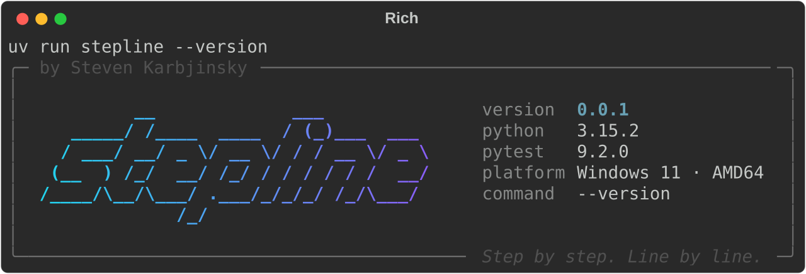

# Getting started

This page takes you from installation to a first check that stepline is active in your
test runs. It takes about two minutes.

!!! abstract "Requirements"

    - **Python 3.15** or newer
    - **pytest**, which stepline installs for you if it is missing

## Installation

stepline is a test tool, so add it as a **development** dependency of your project:

=== "uv"

    ``` bash
    uv add --dev pytest-stepline
    ```

=== "pip"

    ``` bash
    pip install pytest-stepline
    ```

=== "pyproject.toml"

    If you manage dependencies by hand, add stepline to a dependency group:

    ``` toml title="pyproject.toml"
    [dependency-groups]
    dev = [
        "pytest-stepline", # (1)!
    ]
    ```

    1.  Run `uv sync` afterwards to install it. Pin a version range such as
        `pytest-stepline>=0.0.1` once you rely on specific features.

!!! info "One package, two names"

    The package is called `pytest-stepline` on PyPI, following the naming convention for
    pytest plugins. Everywhere else it is simply `stepline`: in your code, on the command
    line and in pytest options.

## Check the installation

### 1. Run your tests

pytest loads stepline automatically, no configuration needed. Run your test suite as usual:

``` bash
uv run pytest
```

The test session header now contains a line for stepline:

``` text hl_lines="3"
=========================== test session starts ===========================
platform linux -- Python 3.15.2, pytest-9.2.0, pluggy-1.7.0
├─ stepline 0.0.1 · Python 3.15.2 · pytest 9.2.0
rootdir: /home/user/my-project
collected 12 items
```

### 2. Use the command-line tool

stepline also installs a CLI. It shows the installed version and your environment:

``` bash
uv run stepline --version # (1)!
```

1.  `-V` is the short form: `uv run stepline -V`.



!!! tip "Narrow terminal?"

    The banner adapts to your terminal width. In a narrow window, the logo moves above the
    information, and in a very narrow one stepline prints a single line instead.

## Switch the plugin off

Sometimes you want a plain pytest run, for example to compare output. The plugin can be
switched off without uninstalling it:

=== "Single run"

    ``` bash
    uv run pytest -p no:stepline
    ```

=== "Always"

    ``` toml title="pyproject.toml"
    [tool.pytest.ini_options]
    addopts = ["-p", "no:stepline"]
    ```

=== "Environment variable"

    ``` bash
    PYTEST_ADDOPTS="-p no:stepline" uv run pytest
    ```

## Troubleshooting

??? question "The stepline line does not appear in the pytest header"

    Most often, pytest runs in a different environment than the one stepline is installed in.

    1. Run pytest through your project tool, for example `uv run pytest`, not a globally
       installed `pytest`.
    2. Check that the package is installed in that environment:

        ``` bash
        uv pip show pytest-stepline
        ```

    3. Make sure the plugin is not switched off by `-p no:stepline` in your `addopts` or in
       `PYTEST_ADDOPTS`.

??? question "Installation fails with a Python version error"

    stepline requires Python 3.15 or newer. Check the version of your project with
    `uv run python --version`, and raise `requires-python` in your `pyproject.toml` if needed.
    With uv, `uv python pin 3.15` sets the version for the project.

??? question "`stepline: command not found`"

    The CLI is installed into your project environment, not globally. Run it through your
    project tool (`uv run stepline --version`) or activate the virtual environment first.

## Next steps

- Read what stepline will offer on the [home page](index.md).
- Follow the progress on the [roadmap].

  [roadmap]: https://github.com/xKabbe/stepline/milestones "Milestones on GitHub"

*[CLI]: Command-line interface
*[PyPI]: Python Package Index
