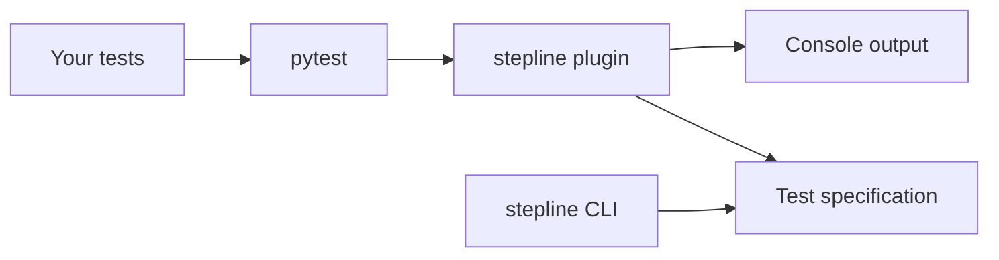

{ width="760" }
{ width="760" }

**stepline** is a [pytest] companion library for structured, readable tests: steps that show
what a test does, typed assertions that say what went wrong, and test documentation that lives
right next to the code.

!!! warning "Early development"

    stepline is in **alpha**. Most features are still being built, and APIs may change between
    releases. The [roadmap] shows what is coming next.

[Get started](getting-started.md){ .md-button .md-button--primary }
[View on GitHub](https://github.com/xKabbe/stepline){ .md-button }

## Why stepline?

A failing test should tell you three things without opening the code: **what** the test was
doing, **where** it stopped, and **why** it failed. Plain pytest gives you a traceback and an
`assert` expression. stepline adds the missing structure around them.

-   :lucide-footprints:{ .lg .middle } __Steps__

    ---

    Split a test into named steps, as a context manager or a decorator, and see exactly which
    step failed.

-   :lucide-target:{ .lg .middle } __Typed assertions__

    ---

    Fluent `assert_that(...)` checks with type-aware methods and failure messages that explain
    the difference.

-   :lucide-tags:{ .lg .middle } __Test metadata__

    ---

    Describe tests and link issues with decorators, then export a test specification without
    running a single test.

-   :lucide-terminal:{ .lg .middle } __Console output__

    ---

    Modern, rich-based output of steps and results, readable in your terminal and in CI logs.

-   :lucide-timer:{ .lg .middle } __Performance__

    ---

    Measure how long steps and tests take, and check them against limits.

-   :lucide-puzzle:{ .lg .middle } __pytest plugin__

    ---

    Installs as a regular pytest plugin and works with your existing setup and fixtures.

## How it fits together

stepline does not replace pytest. It plugs into it and adds structure on top of the tests you
already write:

??? info "What is available today?"

    stepline is built feature by feature, and each feature ships in its own release.
    Right now the package provides the foundation:

    - the **pytest plugin**, which registers itself and shows a `stepline` line in the
      test session header;
    - the **command-line tool** with `stepline --version`.

    Steps, typed assertions, metadata and the rest follow in the next releases. See the
    [changelog] for what changed in each version.

## Project status

| Area                | Where to look                    |
|---------------------|----------------------------------|
| Releases on PyPI    | [pytest-stepline][pypi]          |
| Changes per version | [Changelog][changelog]           |
| What comes next     | [Roadmap (milestones)][roadmap]  |
| Source code         | [xKabbe/stepline][repo]          |

  [pytest]: https://docs.pytest.org
  [pypi]: https://pypi.org/project/pytest-stepline/
  [changelog]: https://github.com/xKabbe/stepline/blob/main/CHANGELOG.md
  [roadmap]: https://github.com/xKabbe/stepline/milestones "Milestones on GitHub"
  [repo]: https://github.com/xKabbe/stepline

*[CLI]: Command-line interface
*[CI]: Continuous integration
*[PyPI]: Python Package Index
